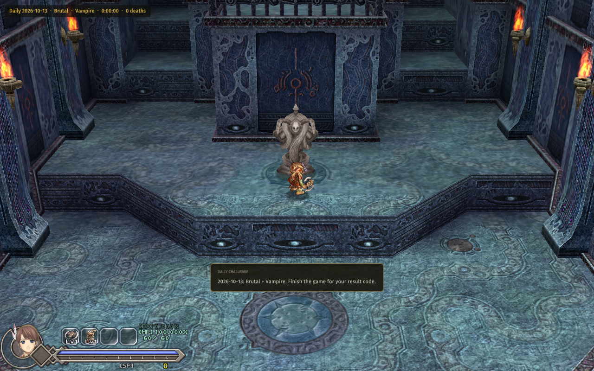

# Daily Challenge

For **Ys Origin** on CleriaCore. **One challenge a day, the same for everyone.** Today's date shuffles the tower's
chests and picks two rules. Finish the game and you get a result code to compare with your friends.



- **The date is the seed** (UTC, so it changes at the same moment for everyone). Start a new game and you play
  today's challenge: no server, no account.
- **Shuffled chests**, always beatable: the same layout for everyone who plays the same character that day.
- **Two rules** out of six: Glass Cannon (double ATK, half HP), Brutal (monsters hit 50% harder), Vampire (no healing
  drops, kills heal), Midas (every drop is gold), Famine (no drops), Scholar (50% more EXP).
- **A result code** when the last boss falls, for example
  `YSO-DAILY 2026-10-13 Toal 3:41:07 2d #9C1E`: the day, your character, your play time, your deaths. It is shown,
  written to a text file, and kept on the mod's page.
- A line in the corner shows the day, the rules, your time and your deaths while you play.

**F1 > Mods > Daily Challenge** shows today's rules before you start, lets you play another day's challenge by
typing its date, and has a switch to start an ordinary game instead.

The code's last four characters are a checksum against typing mistakes. It is not proof of anything: this is for
playing with friends, not for a leaderboard.

Do not turn this on together with the Solo Randomizer (CleriaCore refuses the pair): both shuffle the chests.

## Install

1. Download `4rtefakt.daily-1.0.0.cleriamod` from the [releases](../../releases).
2. Double-click it (or use F1 > Mods > *Install a mod file...*).
3. Turn **Daily Challenge** on in F1 > Mods, restart CleriaCore, and start a **new game**.

Needs a CleriaCore with mod API 6.

## How it works

[main.lua](main.lua) (about 210 lines) plus two things taken as they are from the
[Solo Randomizer](https://github.com/4rtefakt/cleriacore-solo-randomizer): `fill.lua`, which turns a seed into a
beatable chest layout, and `data/`, the tower's logic. The day's part is small:

```lua
local function today() return os.date("!%Y-%m-%d", math.floor(cleria.unix_time())) end
local function rules_of(day)                   -- two different rules from the date
    local h = hash("rules " .. day)
    local a = h % #RULES + 1
    local b = (h >> 8) % (#RULES - 1) + 1
    if b >= a then b = b + 1 end
    return {RULES[a][1], RULES[b][1]}
end
-- on a new game: fill.try(data, "daily-" .. day, attempt) -> the day's layout
```

| Part | API |
|---|---|
| The date | `cleria.unix_time`, `os.date` |
| The chests | `cleria.content.add_filter`, `require` and `cleria.read` on the mod's own files |
| The rules | `player.set_modifier` and the `"damage"`, `"exp"`, `"pickup"`, `"drop"` combat filters |
| The run, kept with the save | `cleria.save` (the day, the layout, the time, the deaths) |
| The result | `boss_defeated`, `cleria.notice`, `cleria.data.write` |
| Not with the Solo Randomizer | `Conflicts=` in `mod.ini` |

## Tests

`python .dev/run.py` runs four cases through CleriaCore's headless harness: a new game on a fixed day gets that
day's two rules and 42 shuffled chests, and gets the same on a second start; a death, a continue and the last
boss's flag give a result code with `1d` (the death survives the continue's reload, and so does the challenge
itself when the death is in the game's first room); the tower's first chest opens under a challenge; turned off, a
new game is an ordinary one.

Not covered: nobody has played a day's challenge to the end, each rule's effect is tested in
[Mutators](https://github.com/4rtefakt/cleriacore-mutators) rather than here, and "always beatable" rests on the
same logic data as the Solo Randomizer (see its README for the limits).

## More CleriaCore mods

Each one is a small Lua mod that shows a different part of the mod API:

- [Mutators](https://github.com/4rtefakt/cleriacore-mutators): challenge rules: Glass Cannon, Berserker, One Hit, Vampire, Midas, Famine, Permadeath, a level cap
- [Solo Randomizer](https://github.com/4rtefakt/cleriacore-solo-randomizer): the tower's chests shuffled from a seed, always beatable, no server
- [Roguelite Perks](https://github.com/4rtefakt/cleriacore-roguelite-perks): every boss beaten lets you choose one of three random perks
- [New Game+](https://github.com/4rtefakt/cleriacore-new-game-plus): start again with part of your level, SP and weapon against a harder tower
- [Level Sync](https://github.com/4rtefakt/cleriacore-level-sync): monsters fight as if they were near your level
- [Adaptive Difficulty](https://github.com/4rtefakt/cleriacore-adaptive-difficulty): enemies hit softer after each death, and return to normal as you progress
- [Achievements](https://github.com/4rtefakt/cleriacore-achievements): thirty achievements kept across all your saves
- [Run HUD](https://github.com/4rtefakt/cleriacore-run-hud): room and run time, kills, deaths, damage per second
- [Bestiary+](https://github.com/4rtefakt/cleriacore-bestiary): a per-save hunting log of every monster killed
- [Autosave+](https://github.com/4rtefakt/cleriacore-autosave): rolling autosaves on a timer, after bosses and in new zones
- [Debug Menu](https://github.com/4rtefakt/cleriacore-debug-menu): change level, SP, items, gear, skills, blessings, warps and flags
- [Crowd Control](https://github.com/4rtefakt/cleriacore-crowd-control): Twitch chat votes on what happens to you
- [LiveSplit Autosplitter](https://github.com/4rtefakt/cleriacore-livesplit): starts and splits LiveSplit over its WebSocket server
- [Archipelago](https://github.com/4rtefakt/ys-origin-cleriacore-ap): the multiworld randomizer client, the biggest one

## About

Written with AI assistance (Claude Code) as a showcase of the CleriaCore mod API, and tested as described above.
MIT license.
